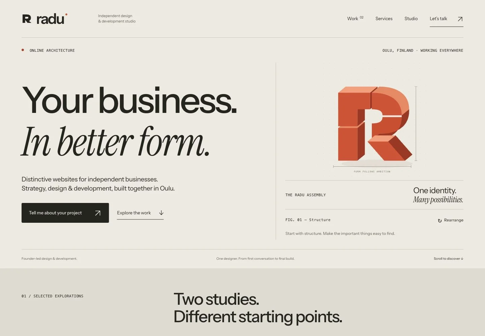
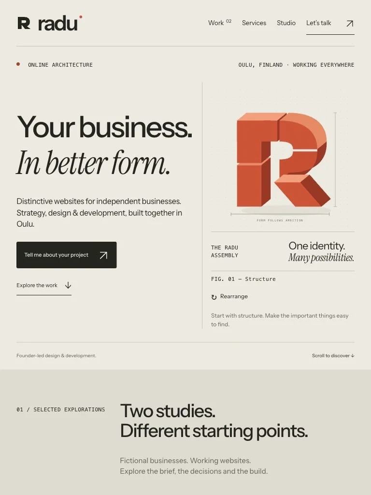
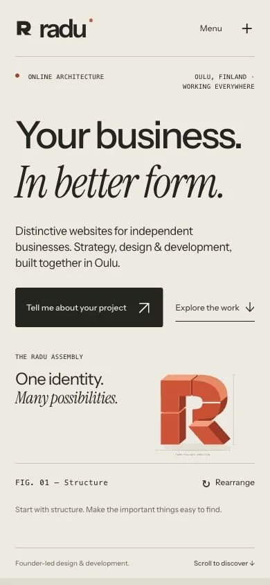
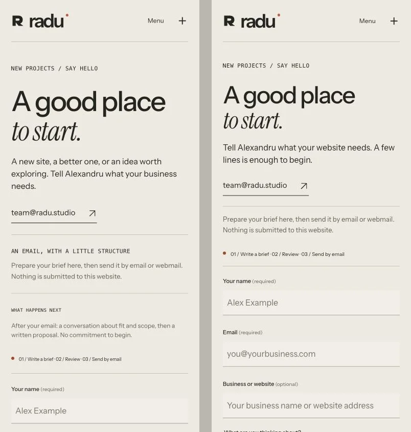
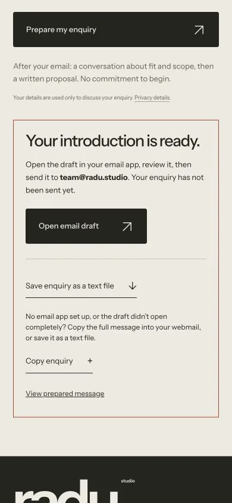
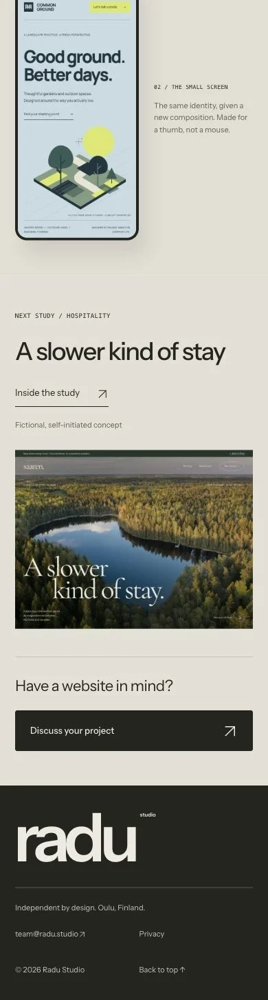

# Radu Studio — art direction and commercial UX review

26 October 2026. Baseline: `cdaf138` on `gh-pages`. Review branch: `design/radu-proof-and-rhythm`. No production publication, merge, DNS change or enquiry email was performed.

## Independent verdict

A coherent emerging independent studio, with a recognizable authored identity and a clear web design/development offer. It is not yet a world-class creative-studio proposition. The modular vermilion R is identifiable; warm paper, grotesk/italic contrast, fine rules, numbered chapters and a giant footer wordmark are familiar boutique-studio conventions. The site has a signature object more than an unmistakable composition system. Visual appearance cannot establish whether a site was generated by AI.

As a prospective buyer, I would consider an introductory conversation for a clearly scoped business website. I would ask for a real delivered site, specific responsibility and evidence of collaboration before entrusting a substantial budget. Two fictional studies demonstrate taste and responsive frontend execution; they do not establish commissioned delivery, client outcomes or a track record.

## Implemented

- Compressed the opening and work introduction while preserving the Radu name, Online Architecture, existing six-module R, mineral/vermilion palette and self-hosted typefaces.
- Replaced repeated sans/italic headline formulas in Work, Services, Studio and case sections with distinct typographic scales and direct language. The hero and closing invitation keep the signature contrast.
- Replaced four process columns with a compact ordered sequence that states the decision or artifact the client reviews at each stage.
- Replaced the generic closing slogan on case pages with the next actual study, a real preview and a labeled project enquiry route. Verified both case navigation and the project CTA in the browser.
- Removed repeated footer sales copy. Made the footer smaller, increased its text size and gave its links 44px minimum height. Restored the text enquiry link that had been hidden at tablet/mobile sizes.
- Removed content-hiding scroll reveals and entrance delays. Kept direct hover feedback, the three-state assembly and the working design desk. Content remains visible while the visitor chooses what to inspect.
- Shortened the mobile enquiry preamble, moved the post-email explanation below the main action, and put optional budget/timing behind a native disclosure. In a 390×844 browser viewport, the name input moved from y=778.7 to y=566.9: approximately 212px earlier. This is a layout measurement, not a conversion claim.
- Corrected the brief-builder wording: it first prepares a message on this page; a separate action opens email or copies to webmail. It never claims receipt.
- Narrowed the retreat case brief to atmosphere, typography and responsive composition. Its demo has no hotel inventory, rates or booking engine; the case no longer suggests it resolves practical guest planning.
- Updated source and all generated pages together. Corrected the README's stale claim that PR #2 was still an unpublished branch.

## Visual evidence

All images below are current browser captures. The before/after is two exact 390×844 screenshots, with the live baseline on the left and the local refinement on the right. These are browser viewports, not physical-device tests.

## Research and prior directions

Current official reference sites were read; current desktop browser screenshots of Order, DIA, MOUTHWASH, BUREAU BORSCHE, Studio Feixen and Exo Ape were also inspected. Reference research is not a full interaction, responsive or accessibility audit of those sites.

| Reference | Useful principle | What to reject for Radu |
| --- | --- | --- |
| [Order](https://order.design/) | Actual outputs at scale; concise project and discipline metadata | Borrowing archive density or prestige Radu has not earned |
| [DIA](https://www.dia.studio/) | A specific archive and motion practice, with literal Work/About/Process/Index | Sparse discovery controls that make a small portfolio harder to understand |
| [MOUTHWASH](https://mouthwash.studio/) | Named projects visibly tied to disciplines; clear navigation | Pretending to have its cultural ecosystem or breadth |
| [BUREAU BORSCHE](https://bureauborsche.com/) | Consistent functional caption/control grammar over actual work | Floating panels and density without a deep archive |
| [Studio Feixen](https://www.studiofeixen.ch/) | Personality proven by the studio's own outputs and categories | Poetic labels or symbols that obscure what clients can buy |
| [Exo Ape](https://www.exoape.com/) | Carefully controlled scale and atmosphere | Copying the oversize-slogan surface as a substitute for originality |

Additional official content comparisons: [PORTO ROCHA](https://www.portorocha.com/), [Garden Eight](https://garden-eight.com/), [Koto](https://koto.com/). The lesson is specificity and inspectable work, not a new palette.

The earlier local atlases, four-direction studies, Marginalia refinement and Made Once refinement were inspected as proposals. They contradict one another about the recommended route; no consistent final selection was established by those artifacts. The current instruction authorizes focused improvements, not the adoption of an old proposal by assumption.

**Editorial folio:** strong when it means deliberate image sequences, useful captions and meaningful scale. Weak when it means fashion-editorial typography, tiny metadata and empty space around the same two thin studies. Marginalia also introduces competing reading columns.

**Made-to-order showroom:** strong when it exposes a real brief, decisions and working output. Weak when catalogue numbering, inspection controls and atelier language imply evidence or bespoke breadth that is absent. “Made once” also fits awkwardly with ongoing care. Keep the proof order; reject the catalogue theatre.

## Git and identity findings

- `b96e779`, 15 May: holding page establishes Radu Studio and Online Architecture, in monochrome.
- `f372330`, 15 October: full site introduces the present modular R, warm palette and type system; `6c07f2d` merges PR #1.
- `5ffa71c`, 22 October: strengthens case presentation and honest enquiry behavior; `b68badf` merges PR #2.
- 25 October: the final four commits change CNAME state, not the visual design. Current baseline is `cdaf138`.

The recognizable current identity is retained. No Friendby or Whumple assets, code, visual systems or backend behavior were used.

## Verification

- Build passes. Static checks pass for 9 HTML documents and 142 local links/assets, metadata, IDs and concept disclosures. `git diff --check` passes.
- Actual screenshots inspected at 1440×1000, 768×1024 and 390×844 for home, enquiry, both cases, privacy, both working concepts and 404: 24 final captures. Lazy case images were scrolled into view before accepting their final captures.
- All 24 final captures have loaded fonts, no pending/failed images and no horizontal document overflow.
- Additional DOM width checks at 320, 600, 1024 and 1920px: no overflow. Total: 56 route/width checks.
- Verified mobile menu expansion, Escape dismissal and focus return; all three assembly states and reset; design desk opening, iframe load and 390px phone mode; case-to-case link and project CTA.
- Verified required-field errors, first-invalid-field focus, valid local draft, optional data inclusion, copy success and invalidation after editing. Did not open or send an email, test mailbox receipt or claim delivery.
- No warning/error entries were returned by the Radu review tab's captured console log.
- Labels, disclosure semantics, focus handling and reduced-motion CSS were inspected. This is not full WCAG certification, a screen-reader test, physical-device testing or a complete cross-browser audit. Reduced-motion preference was not independently toggled in this browser run.

## Remaining priorities

1. **Commissioned proof.** Publish a genuine engagement with attributable scope, decisions, actual deliverables and a working site. Obtain permission before using any client identity, feedback or metrics. Do not turn concepts into client work by renaming labels.
2. **Enquiry delivery.** A brief builder plus mailto/copy remains an extra handoff. A dependable submission endpoint, delivery/error states and verified mailbox receipt would improve the business experience. No provider or account setup is invented here.
3. **Human evidence.** The founder is named, but a real portrait, credible working artifact or specific truthful studio story would support trust more than another graphic treatment. No substitute portrait was generated.
4. **A deeper authored system.** The R is memorable; the surrounding page language remains familiar. Stronger real project art direction and original artifacts will distinguish the studio more than adding effects. The full mobile homepage is still a long conventional studio narrative.
5. **Local fit.** Oulu positioning is clear, but English-only copy may limit local reach. Any Finnish version needs reviewed content and a maintainable language structure.
6. **Tooling note.** Dependency audit reports an existing high-severity advisory in development-only `sharp@0.34.5`. The static site does not ship Sharp. Its upgrade was not bundled into this art-direction change.
